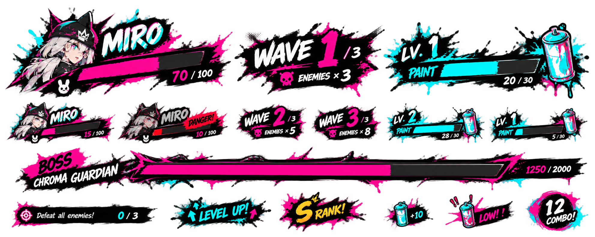
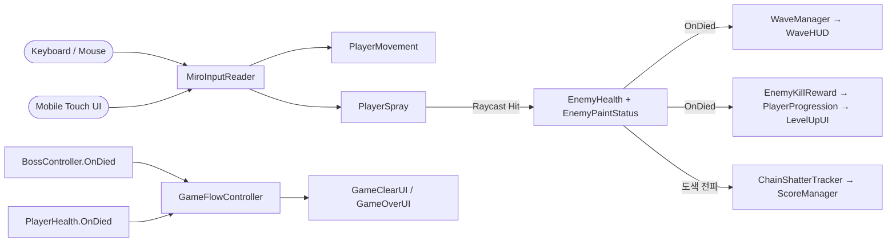
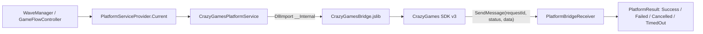

<div align="center">

# ProjectMiro

**Unity 6 (URP) · 도색(Paint) 슈팅 액션 — 웨이브 서바이벌 + CrazyGames SDK 포팅**

적을 스프레이로 "도색"해 처치하는 웨이브 서바이벌 슈터를 Unity에서 구현하고, **PC/WebGL·모바일 통합 입력**과 **CrazyGames 플랫폼 SDK 연동(로그인·리워드 광고·미드게임 광고)**까지 끝까지 포팅한 개인 포트폴리오 프로젝트입니다.

<br>


<br>



<br><br>

**[▶ 플레이 영상 (Google Drive)](https://drive.google.com/drive/u/6/folders/1TdDlTrIju9s5CdsbEaglEBqCquUSSIRw)** &nbsp;·&nbsp;
**[🗺 소스 코드 맵](#source-code-map)**

</div>

---

## Overview

이동·스프레이 공격 → 에너지 획득·업그레이드 → 웨이브 격파 → 보스전 → 클리어/게임오버로 이어지는 루프를, **코드 레벨에서 근거를 남기며** 구현한 프로젝트입니다. 콘텐츠 양보다 **플랫폼 포팅과 시스템 경계 설계**를 검증하는 데 목적을 두었습니다.

- **플랫폼 경계 분리** — 게임 로직은 `IPlatformService` 인터페이스만 참조하고, 실제 CrazyGames SDK 어댑터·Mock 구현·WebGL 폴백은 `PlatformServiceProvider`가 런타임에 선택합니다.
- **입력 통합** — 키보드/마우스와 모바일 터치(조이스틱·홀드 발사·드래그 카메라)를 `MiroInputReader` 한 곳으로 병합해, 전투·이동 로직은 입력 소스를 신경 쓰지 않습니다.
- **판정과 피드백 분리** — `PlayerSpray`의 레이캐스트 판정 → `EnemyHealth`/`EnemyPaintStatus` 상태 갱신 → `ChainShatterTracker`의 연쇄 도색 전파 → `ScoreManager` 점수 반영까지, 이벤트 기반으로 단계를 끊어 연결했습니다.

| | |
|---|---|
| **엔진 / 언어** | Unity 6000.6.3f1 · C# · Universal Render Pipeline |
| **핵심 시스템** | 커스텀 입력 레이어 · NavMesh AI · 오브젝트 풀링 · 플랫폼 어댑터 패턴 |
| **배포 타깃** | WebGL(CrazyGames) · Standalone PC · 모바일 터치 |
| **개발 형태** | 개인 프로젝트 |

---

## Key Features

| 시스템 | 요약 |
|---|---|
| **도색 전투** | `PlayerSpray`의 레이캐스트가 적 명중 시 `EnemyHealth.TakeDamage` + `EnemyPaintStatus.AddPaint`를 호출, 표면 명중 시 `PaintDecalPool`로 데칼 배치 |
| **체인 셰터** | `ChainShatterTracker`가 도색된 적들 사이의 연쇄 파괴를 추적 — 일반 처치 10점, 체인 처치 `20 × 체인 수`, 보스 처치 500점(`ScoreManager`) |
| **PC·모바일 통합 입력** | `MiroInputReader`가 키보드/마우스와 `MobileJoystick`/`MobileSprayButton`/`MobileCameraDragInput`의 터치 입력을 하나로 병합 |
| **적 AI** | `EnemyAI`가 NavMesh 기반 추격·공격 상태를 enum + switch 유한 상태 머신으로 처리 |
| **웨이브 & 보스** | `WaveManager`가 기본 3웨이브(`{5, 8, 10}`)를 순회하고 완료 후 보스를 생성, `BossController` 사망이 `GameFlowController`를 거쳐 클리어로 연결 |
| **성장 시스템** | 적 처치 이벤트로 `EnemyKillReward` → `PlayerProgression` 에너지 획득 → `LevelUpUI` 업그레이드 적용 |
| **오브젝트 풀링** | `PaintDecalPool`, `ImpactSplatPool`이 반복 VFX·데칼의 런타임 Instantiate/Destroy를 줄임 |
| **CrazyGames SDK 연동** | `showAuthPrompt` 기반 실제 로그인, 리워드 광고 부활(`ReviveUI`), 웨이브 중간 미드게임 광고(`ShowMidgameAd`), 광고 중 `AudioListener.pause` 동기화. `SubmitScore`는 대시보드 발급 암호화 키가 필요해 의도적으로 Mock 유지([근거](Assets/Scripts/Platform/CRAZYGAMES_INTEGRATION.md)) |
| **한글 UI 폰트 대응** | 기본 타이틀 폰트(DelaGothicOne_SDF)에 한글 글리프가 없어 `Pretendard-Bold` 기반 Dynamic SDF 폰트를 생성해 `ReviveUI` 등에 적용 |

---

## Architecture

입력부터 전투 판정·피드백까지 이어지는 핵심 데이터 경로입니다.



CrazyGames SDK 왕복 경로( `IPlatformService` 경계 뒤로 숨겨진 어댑터 체인 ):



---

<a name="source-code-map"></a>
## Source Code Map

| 시스템 | 핵심 소스 |
|---|---|
| 입력 통합 | [`MiroInputReader`](Assets/Scripts/MiroInputReader.cs) |
| 이동 · 조준 | [`PlayerMovement`](Assets/Scripts/PlayerMovement.cs) · [`PlayerAimCamera`](Assets/Scripts/PlayerAimCamera.cs) |
| 스프레이 전투 | [`PlayerSpray`](Assets/Scripts/PlayerSpray.cs) · [`PaintDecalPool`](Assets/Scripts/PaintDecalPool.cs) |
| 적 체력 · 도색 상태 | [`EnemyHealth`](Assets/Scripts/EnemyHealth.cs) · [`EnemyPaintStatus`](Assets/Scripts/EnemyPaintStatus.cs) |
| 적 AI | [`EnemyAI`](Assets/Scripts/EnemyAI.cs) |
| 체인 셰터 · 점수 | [`ChainShatterTracker`](Assets/Scripts/ChainShatterTracker.cs) · [`ScoreManager`](Assets/Scripts/ScoreManager.cs) |
| 웨이브 · 보스 | [`WaveManager`](Assets/Scripts/WaveManager.cs) · [`BossController`](Assets/Scripts/BossController.cs) |
| 성장 시스템 | [`PlayerProgression`](Assets/Scripts/PlayerProgression.cs) · [`EnemyKillReward`](Assets/Scripts/EnemyKillReward.cs) |
| 게임 흐름 · 종료 | [`GameFlowController`](Assets/Scripts/GameFlowController.cs) · [`LobbyController`](Assets/Scripts/Lobby/LobbyController.cs) |
| 모바일 입력 | [`Assets/Scripts/Mobile/`](Assets/Scripts/Mobile) |
| 플랫폼 SDK 경계 | [`IPlatformService`](Assets/Scripts/Platform/IPlatformService.cs) · [`PlatformServiceProvider`](Assets/Scripts/Platform/PlatformServiceProvider.cs) · [`CrazyGamesPlatformService`](Assets/Scripts/Platform/CrazyGamesPlatformService.cs) |

> 전체 게임플레이 스크립트는 [`Assets/Scripts`](Assets/Scripts)에 있습니다.

---

## Project Structure

이 저장소는 **코드 레퍼런스 목적**이라 아트·오디오·씬 등 바이너리 에셋은 제외하고, 실제 소스 코드만 올려둡니다.

```
ProjectMiro/
├─ Assets/
│  ├─ Scripts/    게임 로직 전체 (Mobile/, Lobby/, Platform/, Audio/ 등 하위 폴더 포함)
│  ├─ Plugins/    WebGL(jslib) 네이티브 브리지 코드
│  └─ Shaders/    커스텀 셰이더
└─ Tools/webgl-porting-pipeline/src/  WebGL 빌드·검증 파이프라인 소스
```

---

## Getting Started

이 저장소는 **코드만 담은 레퍼런스**이며 바로 빌드/플레이할 수 있는 전체 Unity 프로젝트는 아닙니다. 실제 플레이는 위 [▶ 플레이 영상](https://drive.google.com/drive/u/6/folders/1TdDlTrIju9s5CdsbEaglEBqCquUSSIRw)으로 확인해 주세요.

- 엔진: Unity 6000.6.3f1 · Universal Render Pipeline
- 플랫폼 SDK 경계: 에디터/Standalone에서는 `MockPlatformService`가, WebGL 빌드에서는 `CrazyGamesPlatformService`가 자동으로 선택됩니다.
- WebGL 빌드/검증 과정은 [`Tools/webgl-porting-pipeline`](Tools/webgl-porting-pipeline)을 참고합니다.

---

## Contributors

<table>
  <tr>
    <td align="center">
      <a href="https://github.com/blyuu">
        <br>
        <sub><b>김준수 (blyuu)</b></sub>
      </a><br>
      <sub>Gameplay Programmer</sub>
    </td>
  </tr>
</table>

전투·웨이브·성장 시스템, PC/모바일 통합 입력, CrazyGames SDK 플랫폼 레이어까지 **전 시스템을 단독으로 설계·구현**했습니다.

---

## Credits & Copyright

이 프로젝트는 **학습 및 포트폴리오 목적의 비상업적 프로젝트**입니다.

- 환경 아트 에셋 **PixelDrift Metro Free**(`Assets/EmaceArt/PixelDrift Metro Free`)는 원작자(EmaceArt)의 애셋스토어 라이선스에 따라 사용되었습니다.
- **CrazyGames**와 CrazyGames SDK는 CrazyGames B.V.의 상표이며, 본 프로젝트는 CrazyGames와 제휴·후원 관계가 없습니다.
- 본 저장소의 **게임 코드(`Assets/Scripts/`)는 작성자 본인(김준수)이 작성**했습니다.

<div align="center">
<sub>© 2026 김준수 (blyuu) · 코드/문서에 한함</sub>
</div>
